Министерство науки и высшего образования РФ

Федеральное государственное автономное образовательное учреждение высшего образования

**«СИБИРСКИЙ ФЕДЕРАЛЬНЫЙ УНИВЕРСИТЕТ»**

Институт космических и информационных технологий
Кафедра программной инженерии

---

# ОТЧЁТ №4

### по практической работе на тему «Синтаксический анализ контекстно-свободных языков»

*(Теория автоматов, языков и вычислений)*

---

Преподаватель: В. Н. Мымликов

Студент: Д. Д. Шишко, гр. КИ24-16/1б

Красноярск 2026

<!-- pagebreak -->

## 1 Цель работы и постановка задачи

**Цель работы** — исследование свойств универсальных алгоритмов синтаксического анализа контекстно-свободных языков.

**Вариант задания — № 2.**

> **Часть 1.** Построить КСГ для языка оператора присваивания, в правой части которого задано логическое выражение.
> **Элементы языка:**
> *   Целочисленные константы в шестнадцатеричной системе счисления (`0-9`, `A-F`).
> *   Имена переменных из одного символа (от `g` до `k`).
> *   Знаки операций и скобки.
> *   Приоритет операций (по убыванию): отрицание, мультипликативные, аддитивные, присваивание.
>
> **Часть 2.** Привести полученную грамматику к Нормальной Форме Хомского (НФХ) и продемонстрировать распознавание тестовых цепочек методом Кока-Янгера-Касами (CYK) в системе JFLAP (не менее 10 скриншотов).

---

## 2 Построение грамматики и приведение к НФХ

### 2.1 Исходная грамматика (не в НФХ)

Для задания языка была составлена следующая контекстно-свободная грамматика:

    S -> V = E
    E -> E + T | E - T | T
    T -> T * F | T / F | F
    F -> ! F | ( E ) | V | C
    V -> g | h | i | j | k
    C -> hex-цифра (0-9, A-F), одна или больше

*Примечание:* В связи с тем, что среда JFLAP не позволяет использовать символы `(` и `)` в качестве терминалов (выдает ошибку "reserved character"), в программной реализации они были заменены на `[` и `]`.

### 2.2 Приведение к Нормальной Форме Хомского (НФХ)

Для работы алгоритма CYK грамматика была приведена к НФХ. Каждое правило имеет вид `A -> BC` (два нетерминала) или `A -> a` (один терминал). 

Итоговая грамматика, загруженная в JFLAP (файл `assignment_cnf.jff`), приведена на рисунках 1–5 (правила не помещаются на один экран).

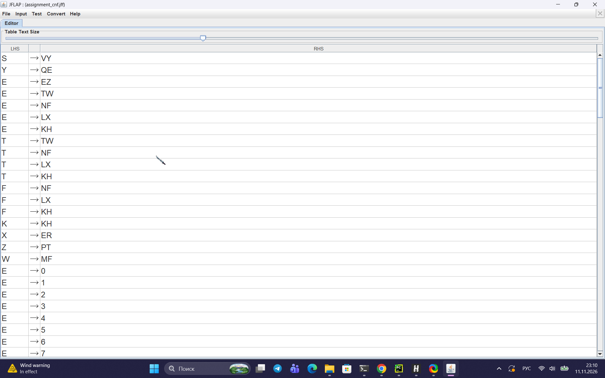

Рисунок 1 — Список правил грамматики в НФХ (часть 1)

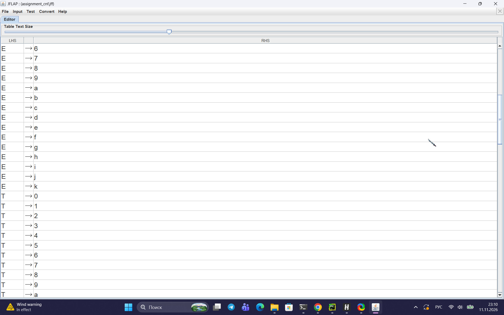

Рисунок 2 — Список правил грамматики в НФХ (часть 2)

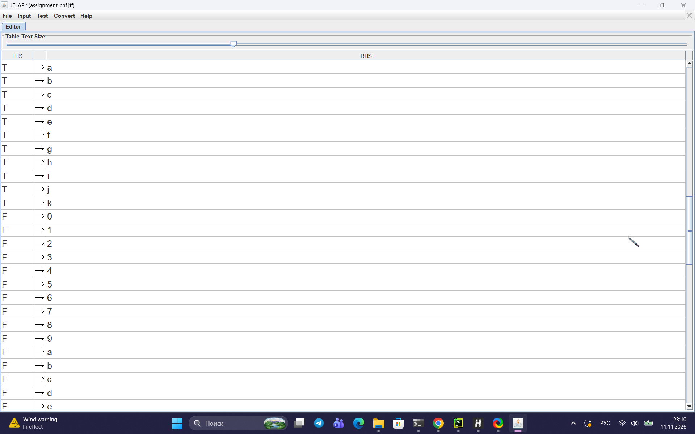

Рисунок 3 — Список правил грамматики в НФХ (часть 3)

Рисунок 4 — Список правил грамматики в НФХ (часть 4)

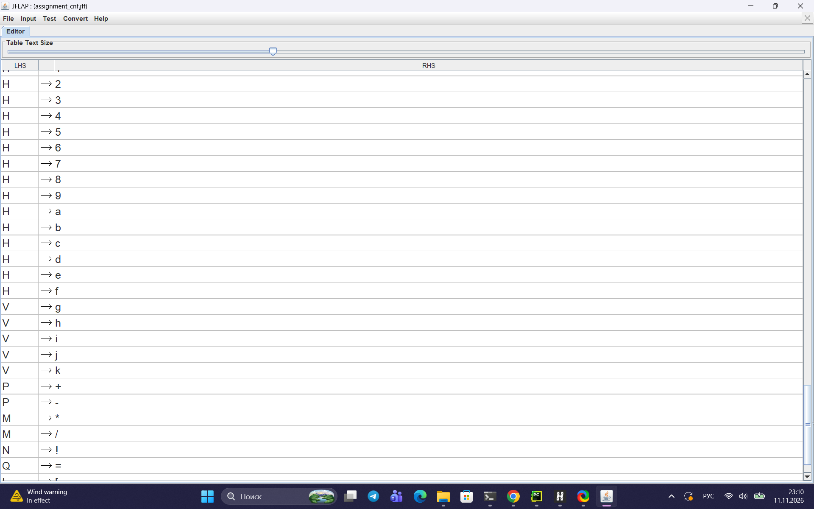

Рисунок 5 — Список правил грамматики в НФХ (часть 5)

*Расшифровка нетерминалов:*
*   `S` — старт (оператор присваивания)
*   `V` — переменная
*   `Q` — знак `=`
*   `E` — выражение (сложение/вычитание)
*   `T` — терм (умножение/деление)
*   `F` — фактор (отрицание/скобки/операнд)
*   `N` — отрицание `!`
*   `L`, `R` — скобки `[` и `]`
*   `P`, `M` — операторы `+ - * /`
*   `H`, `K` — константы (цифры)

---

## 3 Синтаксический анализ методом CYK

В системе JFLAP была загружена полученная грамматика в НФХ. С помощью инструмента **Input -> CYK Parse** были проверены 10 тестовых цепочек.

Все цепочки были успешно распознаны алгоритмом (JFLAP выдал сообщение **"String is Accepted!"** и построил деревья разбора).

### Результаты проверки:

**1. Цепочка `g=5`**
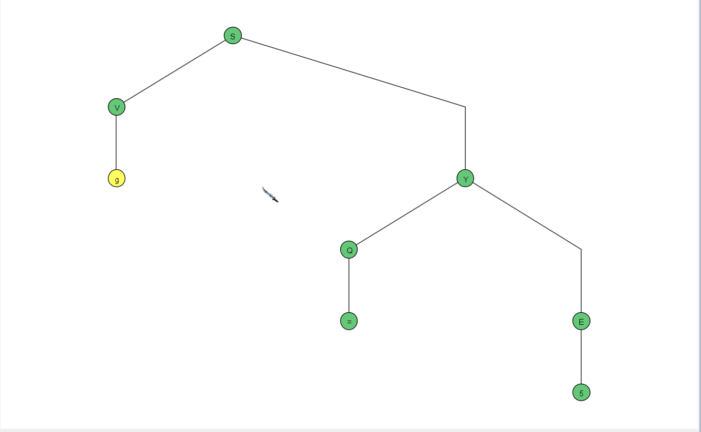

**2. Цепочка `h=1f+a`**
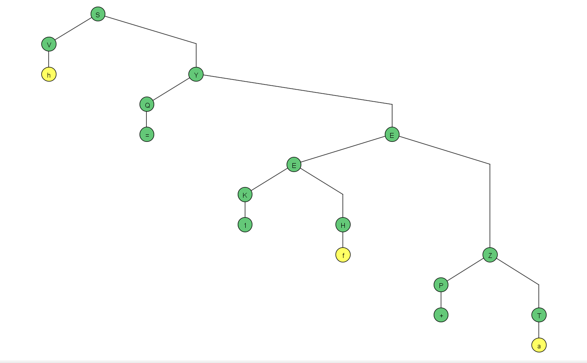

**3. Цепочка `k=!g*2`**
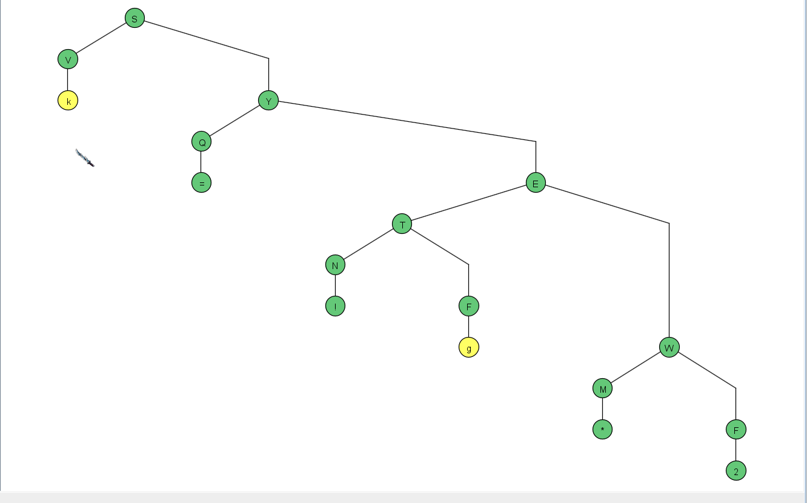

**4. Цепочка `i=!!3-b/c*!h`**
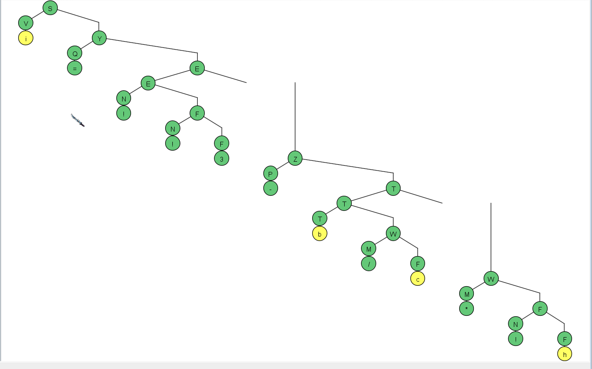

**5. Цепочка `j=12f+!k*0`**
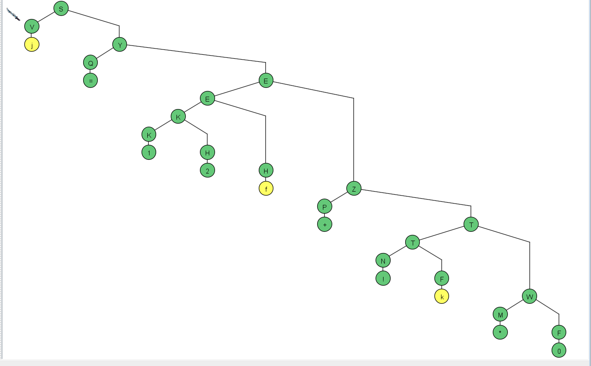

**6. Цепочка `g=a`**
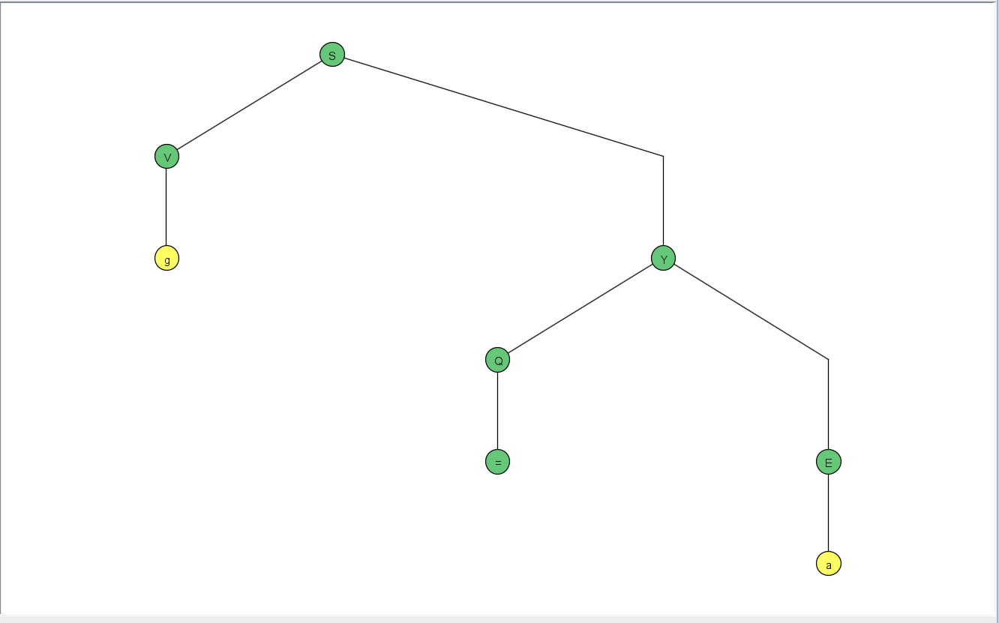

**7. Цепочка `g=[5+a]*k`**
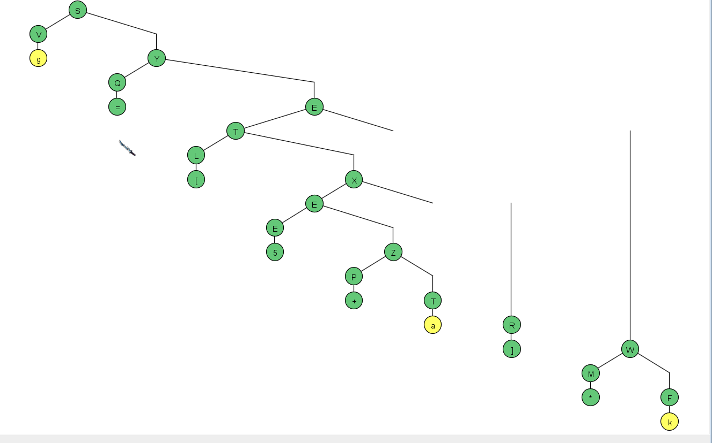

**8. Цепочка `h=[[1]]`**
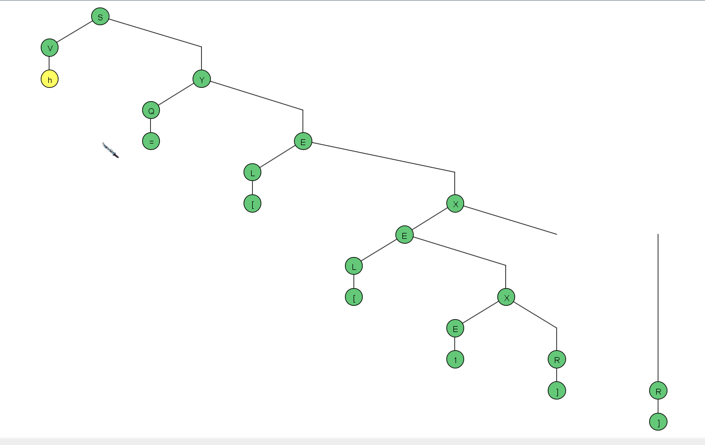

**9. Цепочка `i=[g-1]/!k`**
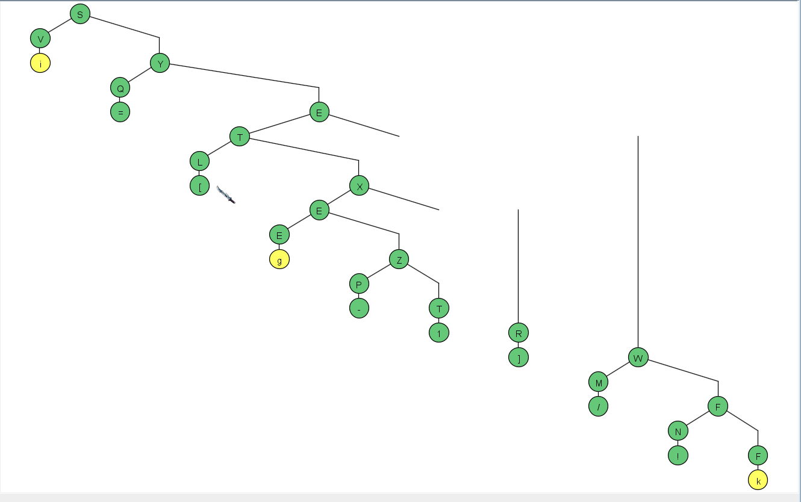

**10. Цепочка `k=!![0]-f`**
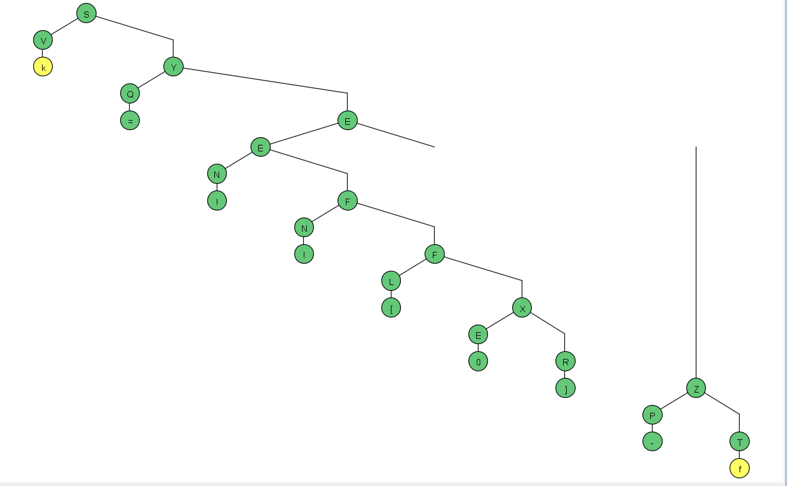

---

## 4 Заключение

В ходе выполнения практической работы была построена контекстно-свободная грамматика для языка логических выражений (вариант 2). Грамматика была приведена к Нормальной Форме Хомского, что позволило применить для её анализа универсальный алгоритм Кока-Янгера-Касами. 

С использованием системы JFLAP были успешно проанализированы 10 тестовых цепочек, включая сложные выражения со скобками, отрицанием и арифметическими операциями. Деревья разбора подтверждают корректность построенной грамматики.